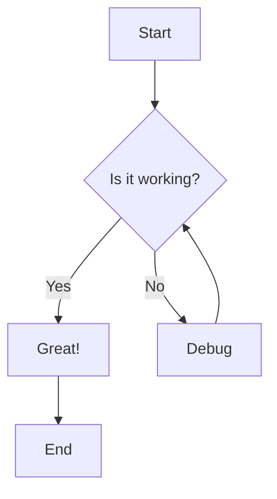
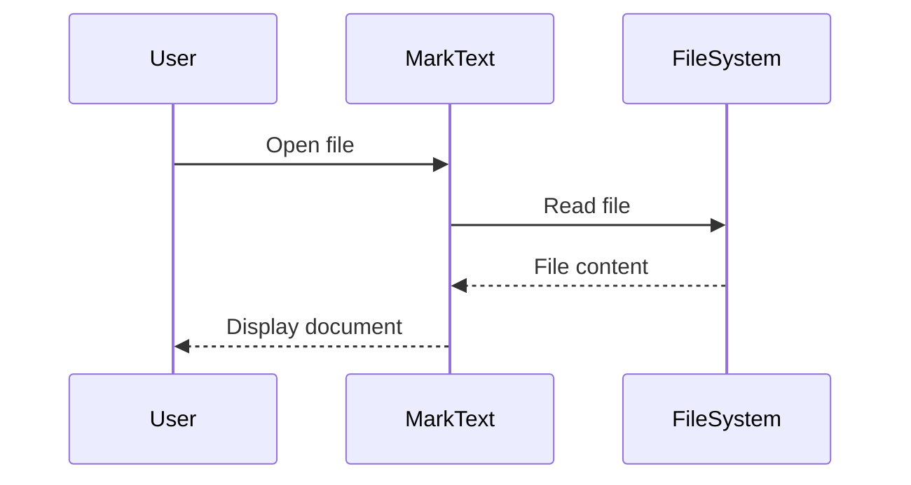
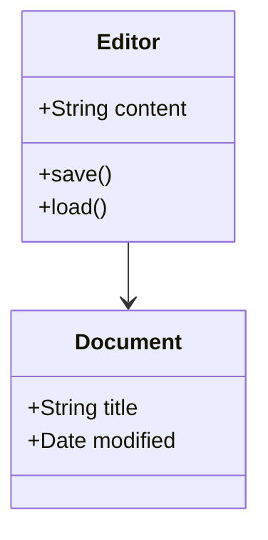
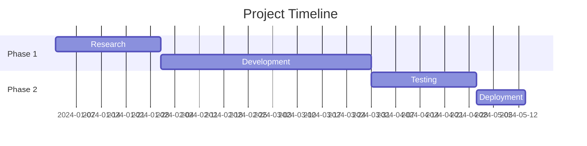
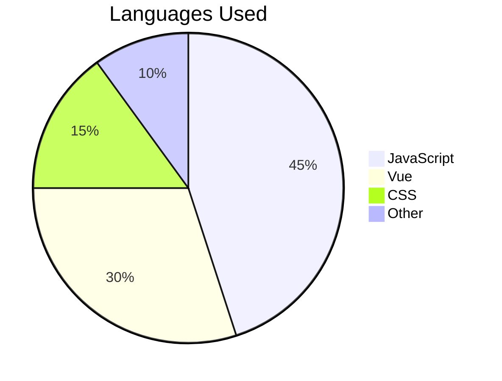

# MarkText Feature Test Document

This document tests all major MarkText features including LaTeX math, diagrams, code highlighting, and more.

---

## 1. LaTeX Math (KaTeX)

### Inline Math

The quadratic formula is $x = \frac{-b \pm \sqrt{b^2-4ac}}{2a}$ and Einstein's famous equation is $E = mc^2$.

Greek letters: $\alpha, \beta, \gamma, \delta, \epsilon, \theta, \lambda, \mu, \pi, \sigma, \omega$

### Block Math

$$
\int_{-\infty}^{\infty} e^{-x^2} dx = \sqrt{\pi}
$$

$$
\sum_{n=1}^{\infty} \frac{1}{n^2} = \frac{\pi^2}{6}
$$

### Matrix

$$
\begin{bmatrix}
1 & 2 & 3 \\
4 & 5 & 6 \\
7 & 8 & 9
\end{bmatrix}
$$

### Chemistry (mhchem)

$$
\ce{H2O -> H2 + 1/2 O2}
$$

$$
\ce{CO2 + C -> 2 CO}
$$

---

## 2. Mermaid Diagrams

### Flowchart



### Sequence Diagram



### Class Diagram



### Gantt Chart



### Pie Chart



---

## 3. Flowchart.js

```flowchart
st=>start: Start
op1=>operation: Initialize
cond=>condition: Valid?
op2=>operation: Process
e=>end: End

st->op1->cond
cond(yes)->op2->e
cond(no)->op1
```

---

## 4. Vega-Lite Charts

```vega-lite
{
  "$schema": "https://vega.github.io/schema/vega-lite/v5.json",
  "description": "A simple bar chart",
  "data": {
    "values": [
      {"category": "A", "value": 28},
      {"category": "B", "value": 55},
      {"category": "C", "value": 43},
      {"category": "D", "value": 91},
      {"category": "E", "value": 81}
    ]
  },
  "mark": "bar",
  "encoding": {
    "x": {"field": "category", "type": "nominal"},
    "y": {"field": "value", "type": "quantitative"}
  }
}
```

---

## 5. Code Highlighting (PrismJS)

### JavaScript

```javascript
const greet = (name) => {
  console.log(`Hello, ${name}!`);
  return { message: `Welcome, ${name}` };
};

async function fetchData(url) {
  const response = await fetch(url);
  return response.json();
}
```

### Python

```python
def fibonacci(n):
    """Generate Fibonacci sequence up to n."""
    a, b = 0, 1
    while a < n:
        yield a
        a, b = b, a + b

# List comprehension
squares = [x**2 for x in range(10)]
```

### Rust

```rust
fn main() {
    let numbers = vec![1, 2, 3, 4, 5];
    let sum: i32 = numbers.iter().sum();
    println!("Sum: {}", sum);
}
```

### SQL

```sql
SELECT users.name, COUNT(orders.id) as order_count
FROM users
LEFT JOIN orders ON users.id = orders.user_id
WHERE users.created_at > '2024-01-01'
GROUP BY users.id
HAVING order_count > 5
ORDER BY order_count DESC;
```

### Shell

```bash
#!/bin/bash
for file in *.md; do
    echo "Processing: $file"
    wc -l "$file"
done
```

---

## 6. Tables

| Feature | Status | Notes |
|---------|--------|-------|
| KaTeX | ✅ | Math rendering |
| Mermaid | ✅ | Diagrams |
| Prism | ✅ | Code highlighting |
| Vega-Lite | ✅ | Charts |
| Front Matter | ✅ | YAML metadata |

### Aligned Table

| Left | Center | Right |
|:-----|:------:|------:|
| L1 | C1 | R1 |
| L2 | C2 | R2 |
| L3 | C3 | R3 |

---

## 7. Front Matter (YAML)

This document should support front matter at the very top:

```yaml
---
title: Test Document
author: MarkText Team
date: 2024-01-01
tags:
  - test
  - markdown
  - features
---
```

---

## 8. Task Lists

- [x] Create test document
- [x] Add LaTeX examples
- [x] Add Mermaid diagrams
- [x] Add code blocks
- [ ] Test PDF export
- [ ] Test HTML export

---

## 9. Blockquotes and Callouts

> This is a blockquote.
> It can span multiple lines.

> **Note:** Important information here.

> **Warning:** Be careful with this feature.

---

## 10. Images and Links

### Links

- [MarkText GitHub](https://github.com/marktext/marktext)
- [KaTeX Documentation](https://katex.org/docs/supported.html)
- [Mermaid Documentation](https://mermaid.js.org/)

### Footnotes

This is a statement with a footnote[^1].

[^1]: This is the footnote content.

---

## 11. Text Formatting

**Bold text** and *italic text* and ***bold italic***.

~~Strikethrough~~ and `inline code`.

Subscript: H~2~O

Superscript: E=mc^2^

==Highlighted text== (if supported)

---

## 12. Horizontal Rules

Use three or more dashes, asterisks, or underscores:

---

***

___

---

## 13. Nested Lists

1. First item
   - Sub-item A
   - Sub-item B
     1. Nested numbered
     2. Another nested
2. Second item
3. Third item

---

## 14. HTML Elements (if allowed)

<details>
<summary>Click to expand</summary>

This content is hidden until expanded.

- Item 1
- Item 2
- Item 3

</details>

---

## End of Test Document

If all sections above render correctly, the MarkText features are working properly.
